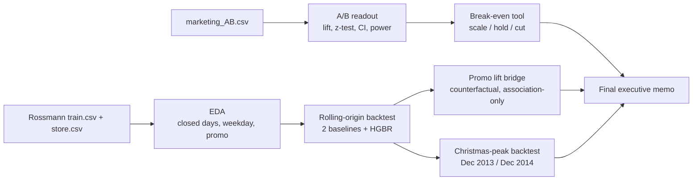

# Retail Growth Diagnostic

**An end-to-end analytics engagement for a fictional retailer: an A/B experiment
readout, a demand forecast, and a promo lift bridge — stitched into one executive
recommendation.**

This project is built to look like real consulting work: every number carries its
denominator, statistical significance is always separated from business
significance, and the places where the data *can't* answer the question are said
out loud rather than hidden.

---

## The business problem

The client asks two questions:

1. **Should we scale the ad campaign?** → answered with an A/B test readout and a
   break-even decision tool.
2. **Are our promotions worth it?** → answered with a counterfactual promo lift
   bridge built on a demand model.

The honest headline is that question 1 can be answered *conditionally* (the lift is
measured; the unit economics are assumed), and question 2 can only be answered
*directionally* (the promo effect is an association, not a causal estimate).

---

## Architecture



| Phase | Script | Deliverable |
|---|---|---|
| 1 | — | [`engagement/engagement_brief.md`](engagement/engagement_brief.md), [`deliverables/memo_template.md`](deliverables/memo_template.md) |
| 2 | [`scripts/ab_experiment_readout.py`](scripts/ab_experiment_readout.py) | [`deliverables/memo_1_experiment.md`](deliverables/memo_1_experiment.md) |
| 2+ | [`scripts/breakeven.py`](scripts/breakeven.py) | [`deliverables/memo_1a_breakeven.md`](deliverables/memo_1a_breakeven.md) |
| 3 | [`scripts/rossmann_eda.py`](scripts/rossmann_eda.py), [`scripts/rossmann_forecast.py`](scripts/rossmann_forecast.py), [`scripts/seasonal_backtest.py`](scripts/seasonal_backtest.py) | [`deliverables/memo_2_forecast.md`](deliverables/memo_2_forecast.md) |
| 5 | — | [`deliverables/final_memo.md`](deliverables/final_memo.md) |

---

## Key findings (all with denominators)

| Question | Finding | Denominator |
|---|---|---|
| **Ads — is there a lift?** | Conversion **2.55% (14,423)** in the ad arm vs **1.79% (420)** in the PSA control → **+0.77pp / +43% relative**, 95% CI **1.30×–1.58×**, p = 1.7×10⁻¹³, **~100% powered** | 588,101 users |
| **Ads — scale?** | **SCALE** on assumed €30/conversion & €0.05/user → net **+€18,077 per 100,000 users**; break-even at **€6.50 per conversion**; positive even at the CI low | 100,000-user cohort |
| **Forecast** | Model WAPE **10.39%** vs seasonal-naive **12.05%** (summer); still wins at peak: **14.52% vs 17.12%** (Dec 2014) | 40,282 / 23,492 open store-days |
| **Promo** | Promotions add an estimated **28.2%** to promo-day revenue (**€38.8m**), vs a naive **38.8%** — association, not causal | 16,701 promo store-days |

The models **do beat their baselines**, but not by a landslide — the forecast gains
**+1.65pp WAPE** over seasonal-naive, and peak error is **~1.4×** the summer error.

---

## Tech stack

| Layer | Tool |
|---|---|
| Language | Python 3.13 |
| Data | pandas, NumPy |
| Statistics | SciPy, statsmodels (proportions z-test, power) |
| Modelling | scikit-learn (`HistGradientBoostingRegressor`) |
| Plots | matplotlib |
| Config | python-dotenv |
| Env | `venv` + pinned [`requirements.txt`](requirements.txt) |
| VCS | git |

---

## Run guide

```bash
# 1. Environment (uses the pinned requirements.txt)
python -m venv venv
./venv/Scripts/python.exe -m pip install -r requirements.txt   # Windows
# source venv/bin/activate && pip install -r requirements.txt  # macOS/Linux

# 2. Inspect the raw data
./venv/Scripts/python.exe scripts/inspect_data.py

# 3. Phase 2 — A/B readout, then the money decision
./venv/Scripts/python.exe scripts/ab_experiment_readout.py
./venv/Scripts/python.exe scripts/breakeven.py --value-per-conversion 30 --ad-cost-per-user 0.05

# 4. Phase 3 — EDA, forecast, peak validation
./venv/Scripts/python.exe scripts/rossmann_eda.py
./venv/Scripts/python.exe scripts/rossmann_forecast.py
./venv/Scripts/python.exe scripts/seasonal_backtest.py
```

All tables and figures land in `deliverables/outputs/`. Data is expected in
`data/raw/` (`marketing_AB.csv`, `train.csv`, `store.csv`) and is gitignored.

---

## Honest limitations

- **No revenue or spend per user.** The A/B file has a binary conversion flag only,
  so the ad recommendation is `lift × assumed unit economics` — a break-even frame,
  not a measured ROI.
- **Promotions are not randomised.** The 28% promo lift is an association from an
  observational model; targeted promo timing means it is an **upper bound**.
- **Peak forecasts are rougher.** WAPE roughly doubles from summer to Christmas
  (10.39% → 14.52% / 23.89%); the 10.39% figure is not a year-round number.
- **One small segment loses.** The model underperforms seasonal-naive on store type
  `b` (11.39% vs 10.00%, n = 714 store-days) — a small-sample result, flagged, not hidden.
- **Rossmann is a public proxy dataset**, not the client's own stores.
- **No test suite exists**; scripts were verified by re-running and inspecting outputs.

---

## What I learned

Building this surfaced several errors that only careful checking caught — the most
useful part of the project:

1. **Never assert an interpretation before computing it.** I first wrote "Saturday is
   the peak trading day" into the EDA, then found the data says **Monday** peaks and
   **Saturday is weakest**. The line is now computed, not hardcoded.
2. **Check your units.** I labelled Rossmann revenue as `£` when the chain is German —
   the unit is `€`. A wrong currency silently corrupts every downstream number.
3. **Don't overstate performance.** An early memo draft said the model "trains in
   ~1 minute," conflating the whole script (3 fits + permutation importance) with a
   single fit. Replaced with the measured figure (~70 s for the full backtest).
4. **Watch small-denominator traps.** Sunday looked like the strongest sales day —
   but only 3,593 of 144,730 Sunday store-days are open (holiday openings), so it is
   a biased sliver and is excluded from the ranking.
